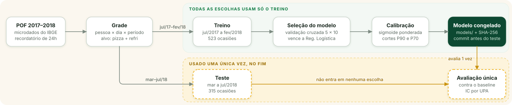
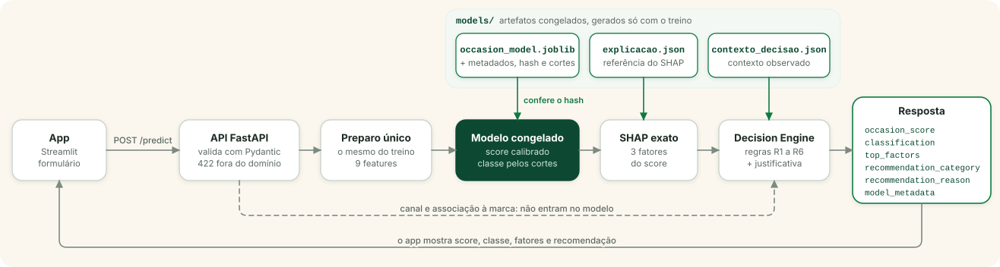
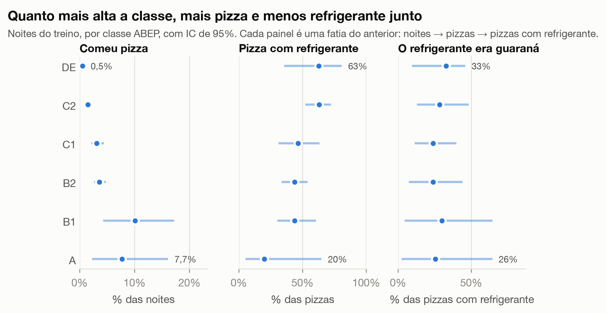
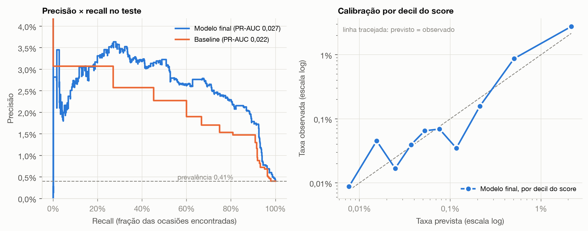
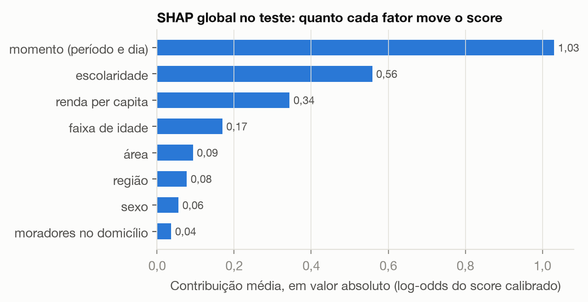
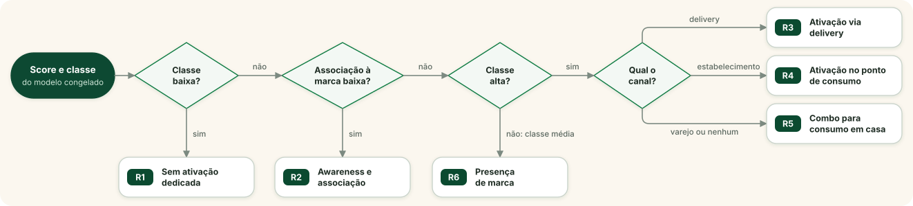

# Occasion Intelligence – Pizza + Guaraná

Projeto do case Inteli Academy x Ambev (TAPI). Estima a propensão da ocasião **Pizza + Refrigerante** por contexto (público, região, dia, período) e transforma o **Occasion Score** em uma recomendação de ativação para Guaraná Antarctica.

> **Entrega:** dados e Data Card, análise exploratória, modelo congelado e avaliado uma única vez no teste, Decision Engine, API e app. Vídeo de demonstração (até 5 min): _link a incluir_.


## Arquitetura

**Como o modelo foi construído e testado.** Todas as escolhas usam só o treino. O teste entra uma única vez, no fim, contra o baseline.



**O caminho de uma requisição.** O app chama a API, que aplica o mesmo preparo do treino e só usa artefatos congelados em `models/`. Canal e associação à marca não entram no modelo: vão direto para o Decision Engine.



| Etapa | Código |
|---|---|
| Download e leitura dos microdados | [src/ingestion](src/ingestion) |
| Mês da entrevista, tipo de área, classe ABEP e a grade com alvo e features | [src/features](src/features) |
| Preparo, modelos, validação, calibração, avaliação e SHAP | [src/models](src/models) |
| Regras e contexto observado | [src/decision_engine](src/decision_engine) |
| API (FastAPI + Pydantic) | [src/api](src/api) |
| App (Streamlit) e fluxogramas | [app](app) |

## Estrutura do repositório

| Pasta | Conteúdo |
|---|---|
| `data/raw` | Microdados originais (não versionados) |
| `data/external` | Dados externos do Mapa de Oportunidade: pizzarias do OpenStreetMap e população do Censo 2022 (versionados; veja [data/external/README.md](data/external/README.md)) |
| `data/processed` | Bases tratadas (`.parquet`) |
| `notebooks/` | EDA e experimentos |
| `src/` | Código do pipeline, do Decision Engine e da API |
| `app/` | App em Streamlit (só fala com o modelo pela API) e os fluxogramas; o tema fica em `.streamlit/config.toml` |
| `models/` | Modelo final congelado antes do teste e seus metadados, a referência do SHAP e o contexto do Decision Engine (versionados) |
| `reports/` | Gráficos para README e vídeo (`figures/`), tabelas da análise exploratória e da avaliação no teste, e a saída da rodada do teste |
| `audit/` | Auditoria dos modelos de 20/11: scripts, saídas e relatório |
| `docs/` | Data Card, notas e regras do Decision Engine |
| `tests/` | Testes (pytest) |

## Dados

- **Fonte do target:** POF 2017–2018 (IBGE), recordatório alimentar de 24h de 46.164 pessoas.
- **Unidade de análise:** pessoa × dia × período (340.072 linhas, 838 ocasiões de pizza + refrigerante).
- **Features:** quando (período, dia da semana), onde (UF, urbano ou rural) e quem (idade, sexo, escolaridade, tamanho da família, renda per capita), escolhidas por triagem com validação cruzada no treino. O modelo final usa o dia da semana na forma de fim de semana (sexta a domingo). Tipo de área e classe ABEP ficam para os segmentos e para o Decision Engine.
- **Validação:** split temporal pelo mês estimado da entrevista (treino jul/2017–fev/2018, teste mar–jul/2018).

Detalhes, decisões e limitações: [docs/data_card.md](docs/data_card.md) e [docs/notas_pof.md](docs/notas_pof.md).

## Análise exploratória

Só com o treino, com taxas ponderadas por `peso_semana` (o peso amostral com cada dia da semana valendo 1/7; ver Data Card, seção 7) e IC de 95% por bootstrap de UPAs ([notebooks/03_eda.py](notebooks/03_eda.py); todas as tabelas em [reports/eda_tabelas.md](reports/eda_tabelas.md)).

1. **A ocasião é da noite e cresce ao longo da semana.** A noite concentra 92% dos casos (481 de 523; 94% com o peso). A taxa noturna vai de 0,50% na segunda a 2,09% no sábado, e sexta a domingo têm 2,4 vezes a taxa de segunda a quinta (IC 1,7 a 3,4). Essa tabela é o baseline do modelo.

   

2. **Classe, tipo de área e idade separam a ocasião mais que região e sexo.** À noite, a taxa vai de 0,34% na classe DE a 4,40% na B1, de 0,23% no rural a 1,71% na capital e de 0,61% aos 60 anos ou mais a 1,82% aos 18–29. Mesmo assim, tipo de área e classe não melhoraram o modelo além de `urbano`, `UF`, renda e escolaridade (ver *Escolha das features*, em Metodologia), e por isso entram como segmentos e no Decision Engine.

   

3. **O salto de fim de semana muda de tamanho entre as classes.** Sexta a domingo multiplicam a taxa noturna por 3,9 na DE (IC 1,1 a 11,7) e na C2 (IC 1,7 a 8,2) e por 3,2 na B1 (IC 1,1 a 12,3), contra 1,5 na B2 (IC 0,6 a 3,2). Não há um padrão claro por renda, e os intervalos são largos: é um indício de interação, não uma prova. É o tipo de efeito que uma regra fixa como "ativar nas noites de sexta" não captura.

   

4. **Quanto mais alta a classe, mais pizza e menos refrigerante junto.** A pizza aparece em 0,5% das noites na DE e em 7,7% na A (10,1% na B1), mas vem com refrigerante em 63% das vezes na DE e em 20% na A (IC 5% a 65%). A participação do guaraná nessas ocasiões não segue a classe (de 24% a 33%, com intervalos sobrepostos); por região, vai de 14% no Norte a 31% no Centro-Oeste, também com intervalos largos. Isso sugere que, nas classes altas, a oportunidade é associar o refrigerante à pizza (awareness), mais do que disputar marca.

   

5. **Três em cada quatro pizzas são comidas em casa, e a região muda mais que a classe.** São 75% no total, com o delivery contado como casa, porque a POF não o separa. A fatia vai de 80% no Sudeste a 56% no Norte (IC 36% a 76%); por classe e tipo de área não há padrão claro. Isso sustenta o consumo em casa como regra padrão do Decision Engine, com a região como modulador.

   

## Metodologia

Protocolo fixado antes da avaliação final no período de teste (mar–jul/2018). O histórico do git registra a data desta seção.

### Occasion Score
- **Definição:** probabilidade estimada de a pessoa comer pizza e tomar refrigerante no período, dado o contexto e o perfil: `P(y = 1 | período, dia da semana, UF, urbano, idade, sexo, escolaridade, tamanho da família, renda per capita)`. O instante de previsão é o início do dia ([Data Card](docs/data_card.md), seção 3).
- **Escala:** de 0 a 1, calibrada. Como a taxa média é baixa (0,30% no treino, ponderada), a aplicação mostra também quantas vezes o score supera essa média.
- **`classification`:** `alta` para os 10% de linhas (pessoa × dia × período) com maior score, `media` para os 20% seguintes e `baixa` para o resto. Os cortes são os percentis 90 e 70 do score, ponderados por `peso_semana`, nas previsões *out-of-fold* do treino. Eles ficam fixos daí em diante e vão no `model_metadata`.

### Métrica principal e custo dos erros
- **Falso positivo:** ativação gasta num contexto sem ocasião. **Falso negativo:** ocasião de pizza + refrigerante que a ativação não alcançou.
- Com orçamento limitado, a marca ativa só o topo do ranking, e os dois custos aparecem ali: a precisão do topo mede o desperdício (FP) e o recall mede as ocasiões perdidas (FN).
- **Principal: PR-AUC** (average precision), que resume precisão × recall em todos os cortes. Um score sem sinal tem PR-AUC igual à prevalência, então o ganho se lê como múltiplo dela.
- **Leitura de negócio: captura no top 10%**, a fração das ocasiões que cai nos 10% de linhas com maior score.
- **Por que não acurácia nem ROC-AUC:** com 99,7% de negativos, as duas ficam altas mesmo com um topo ruim. O ROC-AUC entra como complementar.

### Baseline e candidatos
- **Baseline:** taxa ponderada de `y` por dia da semana × período no treino (28 células), usada diretamente como score. É o "sexta à noite é bom para pizza" em forma de número.
- **Regressão Logística:** categóricas em one-hot, numéricas padronizadas (anos de estudo, moradores e log da renda per capita) e regularização L2; `regiao` no lugar de `UF` (27 categorias são muitas para 523 positivos), `faixa_idade` no lugar de `idade` (o efeito da idade não é linear) e interação período × dia da semana, para conter o baseline. Na seleção, o fim de semana entrou no lugar do dia da semana (ver Resultados).
- **LightGBM raso:** poucas folhas e `min_child_samples` alto, porque o treino tem só 523 positivos.
- **Preparo único:** todo modelo começa pelo mesmo preparo de features ([src/models/preparo.py](src/models/preparo.py)), que a API e o app também usam. Ele não aprende nada dos dados, porque faixas e regiões são fixas, e recusa valores que o modelo não conhece.

### Validação
1. **Validação cruzada repetida no treino** (jul/2017–fev/2018): `StratifiedGroupKFold` com 5 folds, agrupado por domicílio para que a mesma família (que divide a pizza) não fique dos dois lados, e repetido 10 vezes com partições diferentes. Com só 523 positivos, uma única partição é ruidosa demais para decidir. A PR-AUC ponderada decide:
   - o modelo final (Regressão Logística ou LightGBM);
   - as alternativas do Data Card: dia da semana ou fim de semana, renda contínua ou em faixas;
   - hiperparâmetros, uso do `peso_semana` no ajuste e calibração (sigmoide sobre as previsões *out-of-fold*, se a curva de confiabilidade pedir).

   Entre duas opções, a mais complexa só vence se o ganho for significativo a 5% no teste t corrigido para validação cruzada repetida (Nadeau e Bengio, 2003); senão, fica a mais simples. Os hiperparâmetros seguem só a maior PR-AUC média.
2. **Teste temporal** (mar–jul/2018): o modelo escolhido, treinado em todo o treino, é avaliado **uma única vez**, ao lado do baseline. Nada é reajustado depois; qualquer mudança posterior é reportada como exploratória. A aplicação usa esse mesmo modelo.
3. **Generalização por região** (complementar): dentro do treino, ajustar com 4 regiões e avaliar na 5ª.

**Escolha das features.** Uma triagem com essa validação cruzada repetida, só no treino ([notebooks/02_triagem_features.py](notebooks/02_triagem_features.py)), testou cinco grupos de candidatas: tipo de área, classe ABEP, composição da família, bens e finanças, trabalho e estudo. Nenhum trouxe ganho significativo, nem no LightGBM nem na Regressão Logística, então ficaram as 9 features de partida ([Data Card](docs/data_card.md), seção 3). Ela substituiu duas versões anteriores. Uma, exploratória e de 16/11, mediu no período de teste o ganho das candidatas sobre um LightGBM com as mesmas 9 features e indicou incluir tipo de área e classe ABEP, que esta triagem descartou. A outra usou uma única partição e se mostrou instável (ver o adendo de 20/11, abaixo). As features não mudam depois do teste.

### Avaliação no teste
- **Métricas, sempre ao lado do baseline:** PR-AUC; captura no top 5%, 10% e 20%; ROC-AUC; precisão, recall, F1 e matriz de confusão no corte de `alta`; Brier e curva de calibração.
- **Peso:** métricas ponderadas por `peso_semana`, o PESO_FINAL ajustado para cada dia da semana valer 1/7. O PESO_FINAL expande pessoas, não dias, e a amostra tem poucas sextas e sábados (9% e 5% dos dias). A versão sem peso fica como checagem.
- **Incerteza:** intervalos de 95% por bootstrap de UPAs (1.000 reamostragens), como na análise exploratória. A UPA é a unidade primária da amostra e contém os domicílios, onde os positivos se concentram (os 315 do teste estão em 189 domicílios). O modelo só é declarado melhor que o baseline se o intervalo da diferença de PR-AUC (bootstrap pareado) não incluir zero.
- **Mudança de prevalência:** a taxa sobe de 0,30% no treino para 0,41% no teste. A comparação com o baseline é sempre no mesmo conjunto, e o score não é recalibrado com o teste.
- **Segmentos:** período, região, tipo de área e público (classe ABEP, faixa etária, sexo). Para canal, usa-se o local onde a pizza foi comida (`local_pizza`: casa, estabelecimento ou outro lugar fora). Como o local só existe para quem comeu pizza, o resultado por canal é a captura das ocasiões de cada local. Segmentos com menos de 30 positivos no teste são só descritos, sem métrica.
- **Erros:** perfil das ocasiões que ficaram em `baixa` (falsos negativos) e dos contextos em `alta` sem ocasião (falsos positivos).
- **Explicações:** SHAP global e local. Os 3 fatores de maior contribuição de cada previsão formam o `top_factors` da API.

### Adendo de 20/11/2026 (antes de abrir o teste)
Acrescentado depois da auditoria dos modelos e antes de qualquer avaliação no teste. Não muda o modelo nem as regras acima: só detalha como o resultado do teste será lido.
- **Referência para comparar com o teste:** no teste, a PR-AUC é calculada uma vez sobre todas as linhas. A referência comparável da validação cruzada é a PR-AUC agregada das previsões out-of-fold: 0,0276 no modelo final e 0,0143 no baseline ([notebooks/05_robustez.py](notebooks/05_robustez.py), seção 1). A média dos folds (0,0371 e 0,0160) sai enviesada para cima, porque cada fold tem cerca de 105 positivos. A regra para declarar o modelo melhor que o baseline não muda.
- **Resultado por mês:** PR-AUC, captura e taxa prevista × observada em cada mês do teste (março a julho), só como descrição. O motivo: dentro do treino, na validação com origem móvel, o ganho sobre o baseline variou entre janelas. Além disso, o período de teste tem a Copa do Mundo e as festas juninas, que o treino não tem.
- **Comparação exploratória com o dia da semana:** a Regressão Logística com dia da semana e interação período × dia (C = 0,03, sem peso no ajuste) entra no relatório do teste só como comparação.
  - Ela recebe a mesma calibração do modelo escolhido: sigmoide ponderada sobre as previsões out-of-fold das mesmas 50 partições e ajuste final em todo o treino com C × 4/5.
  - São comparadas a PR-AUC agregada, a captura e a calibração por dia da semana.
  - O modelo da aplicação continua o de [models/](models/), qualquer que seja o resultado.
- **Leitura anterior do período de teste:** em 16/11, uma triagem exploratória, feita fora do repositório, mediu no período de teste o ROC-AUC nas noites de um LightGBM com as mesmas 9 features (0,814) e o ganho de grupos de candidatas.
  - As inclusões decididas ali (tipo de área e classe ABEP) foram descartadas pela triagem atual, feita só no treino.
  - Nenhuma escolha do modelo final usa o teste, mas o período de teste não é inédito.

## Resultados

### Seleção do modelo (validação cruzada no treino)

Tudo no treino, com as 50 partições e as regras da Metodologia ([notebooks/04_modelagem.py](notebooks/04_modelagem.py)). PR-AUC e captura são ponderadas por `peso_semana`. A prevalência, que é a PR-AUC de um score sem sinal, é 0,0030. Cada passo parte do vencedor do anterior, e a opção mais complexa só vence com ganho significativo.

| Passo | Mais simples (PR-AUC) | Mais complexa (PR-AUC) | Ganho da mais complexa (p) | Fica |
|---|---|---|---|---|
| Modelo | baseline dia × período (0,0160) | Regressão Logística (0,0386) | +0,0226 (0,006) | Regressão Logística |
| Dia | fim de semana (0,0371) | dia da semana (0,0386) | +0,0015 (0,40) | fim de semana |
| Renda | contínua (0,0371) | 5 faixas (0,0306) | −0,0065 (0,76) | contínua |
| Peso no ajuste | sem peso (0,0371) | `peso_semana` (0,0414) | +0,0043 (0,22) | sem peso |
| Algoritmo | Regressão Logística (0,0371) | LightGBM raso, melhor de 6 (0,0284) | −0,0087 (0,82) | Regressão Logística |

- **Quais opções contam como mais simples** ficou escrito no notebook antes de rodar. Para as alternativas do Data Card e para o LightGBM, isso segue o número de parâmetros.
- **O peso no ajuste** era a decisão sem uma ordem óbvia. O ajuste sem peso foi tratado como o mais simples. O ajuste com peso teve a maior PR-AUC média, mas oscilou mais entre os folds (desvio-padrão de 0,0245 contra 0,0188), e o ganho não foi significativo. Tratado como hiperparâmetro (maior média), ele teria vencido.
- **Modelo escolhido:** Regressão Logística com regularização L2 (C = 0,003), ajustada sem peso. Usa:
  - período, fim de semana (sexta a domingo) e a interação período × fim de semana;
  - região, urbano, faixa etária e sexo;
  - anos de estudo, moradores e log da renda per capita.
- **Desempenho na validação cruzada:** PR-AUC 0,0371, 12,3 vezes a prevalência, contra 0,0160 do baseline (ganho +0,0211, p = 0,013, à frente em 48 de 50 folds). Captura no top 10%: 66,9%, contra 54,2% do baseline.
- **PR-AUC agregada:** a PR-AUC acima é a média dos 50 folds, como manda o protocolo. Calculada sobre todas as previsões out-of-fold de cada repetição, ela é 0,0276 no modelo final (9,1 vezes a prevalência) e 0,0143 no baseline.
  - Com ela, o modelo fica 1,9 vezes à frente do baseline, e não 2,3.
  - A diferença vem do tamanho da amostra de cada cálculo: com cerca de 105 positivos por fold, a PR-AUC sai enviesada para cima ([notebooks/05_robustez.py](notebooks/05_robustez.py), seção 1).
  - A captura no top 10% quase não muda: 66,9% contra 53,6% na versão agregada.

**Calibração.** A regularização forte deixa o score achatado em torno da média. Nas previsões out-of-fold:
- **Sem sigmoide:**
  - a média ficava abaixo da taxa ponderada (0,259% contra 0,302%);
  - no 1% de maior score, a previsão era 1,18% contra 4,45% observados;
  - na metade de baixo, 0,13% contra 0,02%.
- **Com sigmoide:** a sigmoide ponderada (a = 2,50, b = +8,23) estica o score sem mudar a ordem. Medida com a sigmoide ajustada fora de cada fold:
  - reduziu o log loss ponderado de 0,01796 para 0,01667 (p < 0,001);
  - acertou o nível geral (0,304% previsto contra 0,302%).
- **Desvios que ficam:**
  - no topo: no 1% de maior score, 5,7% previsto contra 4,4% observado; entre 5% e 10%, 1,1% contra 1,6%;
  - por dia, porque o modelo junta sexta com sábado e domingo: a sexta fica acima (0,47% previsto contra 0,31%) e a quinta abaixo (0,18% contra 0,28%).

**Modelo final.** O modelo final foi ajustado em todo o treino com C × 4/5 = 0,0024 ([src/models/treinar.py](src/models/treinar.py)).
- **Por quê:** no scikit-learn, o mesmo C regulariza relativamente menos quando há mais linhas. Cada modelo da validação cruzada usou 4/5 do treino, e a sigmoide foi ajustada nas previsões deles.
- **O efeito:** com o C da validação, o modelo final saía menos achatado, e o score calibrado ficava 16% acima da taxa do treino (0,351% contra 0,302%). Com C × 4/5, fica em 0,302%.
- **Quando foi feito:** tudo isso foi detectado e corrigido só com o treino, antes do teste. A validação cruzada aninhada confirmou a correção fora da amostra: sem ela, o score calibrado sairia em 0,403% para uma taxa de 0,302%; com ela, sai em 0,302% ([notebooks/05_robustez.py](notebooks/05_robustez.py), seção 9).
- **Reprodução:** um novo treino reproduz a sigmoide, os cortes e os scores exatamente, mas não o arquivo byte a byte. O SHA-256 dos metadados confere a integridade do arquivo, não a reprodução.

O modelo, a sigmoide, os cortes e as métricas estão em [models/](models/).

**Classificação.** Os cortes são fixos e vão no `model_metadata`. Os números abaixo são das previsões out-of-fold calibradas do treino:

| Classe | Score | Contextos | Ocasiões capturadas | Taxa observada | Vezes a média |
|---|---|---|---|---|---|
| `alta` | a partir de 0,777% | 10% | 67,0% | 2,03% | 6,7 |
| `media` | de 0,144% a 0,777% | 20% | 27,4% | 0,41% | 1,4 |
| `baixa` | abaixo de 0,144% | 70% | 5,6% | 0,02% | 0,1 |

### Robustez (checagens no treino)

As checagens foram feitas depois da seleção e da auditoria de 20/11, antes do teste ([notebooks/05_robustez.py](notebooks/05_robustez.py)). Elas descrevem o modelo escolhido e não mudam nada nele.

**Ao longo do tempo.** A validação cruzada da seleção usa partições aleatórias. Treinando com os meses anteriores e validando nos seguintes, o ganho sobre o baseline variou:

| Janela (treina → valida) | Positivos | PR-AUC baseline | PR-AUC final | Captura baseline | Captura final | Diferença de PR-AUC (IC 95%) |
|---|---|---|---|---|---|---|
| jul–set → out–nov | 151 | 0,0124 | 0,0291 | 45,4% | 62,3% | +0,0026 a +0,0580 |
| jul–nov → dez–jan | 105 | 0,0128 | 0,0151 | 55,1% | 42,1% | −0,0071 a +0,0269 |
| jul–jan → fev | 67 | 0,0250 | 0,0382 | 71,9% | 74,4% | −0,0028 a +0,0550 |

- O ganho só foi significativo na primeira janela.
- Em dez–jan, a captura do modelo ficou abaixo da do baseline.
- A Regressão Logística com dia da semana ficou à frente do modelo final nas três janelas, com PR-AUC de 0,0303, 0,0174 e 0,0490. Por isso ela entra como comparação exploratória no teste (adendo de 20/11).

**Em regiões não vistas.** Treinando com 4 regiões e avaliando na 5ª, o modelo supera o baseline em todas, com o intervalo da diferença acima de zero:

| Região avaliada | Positivos | PR-AUC baseline | PR-AUC final | Captura baseline | Captura final | Diferença de PR-AUC (IC 95%) |
|---|---|---|---|---|---|---|
| Norte | 66 | 0,0097 | 0,0190 | 49,7% | 67,8% | +0,0019 a +0,0326 |
| Nordeste | 171 | 0,0112 | 0,0263 | 57,0% | 74,8% | +0,0052 a +0,0457 |
| Sudeste | 113 | 0,0189 | 0,0349 | 61,3% | 62,4% | +0,0008 a +0,0618 |
| Sul | 95 | 0,0169 | 0,0309 | 38,8% | 61,2% | +0,0050 a +0,0417 |
| Centro-Oeste | 78 | 0,0109 | 0,0203 | 44,6% | 52,5% | +0,0015 a +0,0451 |

**Outras checagens:**
- **Vizinhança:** com partições por UPA em vez de domicílio, a PR-AUC média dos folds fica em 0,0359 no modelo final e 0,0163 no baseline, contra 0,0371 e 0,0160 por domicílio. Não há otimismo por vizinhos parecidos.
- **Poucos positivos efetivos:** como o `peso_semana` varia muito, os 523 positivos equivalem a 138 nas métricas ponderadas (tamanho efetivo de Kish).
  - A PR-AUC do modelo final vai de 0,0116 a 0,0905 entre os folds.
  - Sem peso, a conclusão é a mesma: 0,0248 contra 0,0116 do baseline.
  - Diferenças entre candidatos do tamanho das vistas na seleção (até 0,009) ficam abaixo do que o protocolo consegue separar.
- **Calibração por segmento:** com a sigmoide ajustada fora de cada fold, o nível geral bate, mas alguns segmentos com 30 ou mais ocasiões se afastam mais de 30%. A razão observado ÷ previsto fica em:
  - subestimados: 10–17 anos 1,78; B1 1,54; quinta 1,52; C2 1,30;
  - superestimados: renda acima de 5 salários mínimos 0,55; rural 0,63; sexta 0,66; 45–59 anos 0,69; B2 0,73; Centro-Oeste 0,74.

  Com o dia da semana, o erro médio da calibração por dia cairia de 21% para 16%.
- **Taxa por mês:** no treino, janeiro tem taxa bem menor que os outros meses: 0,133% (IC 0,072% a 0,191%), contra 0,28% a 0,39%. O mês não é feature.

### Avaliação no teste

O modelo congelado foi avaliado uma única vez no teste (mar–jul/2018), em 21/11/2026, com o notebook commitado antes da rodada ([notebooks/06_teste.py](notebooks/06_teste.py), commit c819652). As tabelas completas estão em [reports/teste_tabelas.md](reports/teste_tabelas.md) e a saída da rodada em [reports/teste_saida.log](reports/teste_saida.log).

O teste tem 116.316 linhas e 315 ocasiões em 189 domicílios (118 ocasiões efetivas), com taxa ponderada de 0,406%. As métricas são ponderadas por `peso_semana`, com intervalo de 95% por bootstrap pareado de UPAs (1.000 reamostragens).

**Pela regra fixada antes, o modelo final não pode ser declarado melhor que o baseline.** A diferença de PR-AUC foi de +0,0045, com intervalo de −0,0029 a +0,0138, que inclui zero. Em 89,8% das reamostragens a diferença foi positiva.

| Métrica | Modelo final | Baseline | Validação cruzada (agregada): final / baseline |
|---|---|---|---|
| PR-AUC | 0,0265 (0,0190 a 0,0384) | 0,0220 (0,0138 a 0,0344) | 0,0276 / 0,0143 |
| PR-AUC ÷ prevalência | 6,5 vezes | 5,4 vezes | 9,1 / 4,7 vezes |
| Captura no top 5% / 10% / 20% | 39,6% / 67,8% / 89,2% | 34,3% / 57,1% / 78,5% | top 10%: 66,9% / 53,6% |
| ROC-AUC | 0,890 | 0,860 | |
| Precisão / recall / F1 no corte de `alta` | 2,7% / 68,6% / 5,2% | 2,3% / 60,0% / 4,4% | |
| Brier | 0,00401 | 0,00400 | |



- **O modelo manteve o nível da validação, e o baseline melhorou:**
  - A PR-AUC foi de 0,0265 no teste, contra 0,0276 na validação.
  - A captura no top 10% foi de 67,8%, contra 66,9%.
  - A classe `alta` reuniu 68,6% das ocasiões em 10,4% do peso, contra 67,0% em 10% na validação.
  - O baseline subiu de 0,0143 para 0,0220 de PR-AUC. Foi isso que encolheu a distância entre os dois.
- **Todas as métricas de ordenação ficaram a favor do modelo, nenhuma com significância:**
  - A captura no top 10% ficou 10,8 p.p. acima, com intervalo de −1,1 a +19,6 p.p.
  - Sem peso, a PR-AUC foi de 0,0236 contra 0,0169 e a captura de 73,0% contra 59,8%.
- **Calibração:** sem recalibrar, o score médio ficou em 0,320%, e a taxa observada foi 27% maior, de 0,406%. Isso acompanha a alta da prevalência de 0,30% no treino para 0,41% no teste. Nos dois decis de maior score, a taxa observada ficou 72% e 28% acima da prevista. O Brier ficou igual ao do baseline (0,00401 contra 0,00400) e abaixo do de uma taxa constante (0,00405).
- **Segmentos com 30 ocasiões ou mais:**
  - À noite, onde estão 286 das 315 ocasiões, a PR-AUC foi de 0,0284 contra 0,0236. O modelo pôs 75,5% das ocasiões da noite em `alta`, contra 66,1% do baseline.
  - Dentro de cada segmento, a PR-AUC do modelo foi maior em Norte, Nordeste, Sudeste, região metropolitana, interior urbano, classes DE, C2 e C1, de 18 a 59 anos e nos dois sexos. A do baseline foi maior em Sul, Centro-Oeste, capital, classe B2 e 10 a 17 anos.
  - Ordenar melhor dentro do segmento não garante mais ocasiões em `alta`, porque o corte de `alta` é um só para todos. Em três segmentos, o modelo pôs em `alta` menos ocasiões que o baseline: Norte (46% contra 67%), classe DE (30% contra 59%) e 10 a 17 anos (44% contra 66%). Renda e escolaridade, que pesam no score, são mais baixas nesses grupos.
  - Os adolescentes de 10 a 17 anos foram o pior caso: a taxa observada foi 3,24 vezes a prevista (1,78 no treino).
- **Canal (local da pizza):** ficaram em `alta` 69,2% das ocasiões em casa (58,2% no baseline) e 75,6% das em estabelecimento (65,7%). Das ocasiões em outro lugar fora de casa, ficaram 57,6% (65,9%).
- **Por mês:** o modelo teve a maior PR-AUC em março, maio e julho, e o baseline em abril e junho; a Copa do Mundo começou em 14 de junho. A taxa observada ficou de 0,97 a 1,88 vezes a prevista. O valor mais alto foi em julho, que tem só 32 ocasiões.
- **Regressão Logística com dia da semana (exploratória, adendo de 20/11):**
  - A PR-AUC foi de 0,0300 contra 0,0265, com diferença de +0,0034 (intervalo de −0,0012 a +0,0080).
  - A captura foi de 66,0% contra 67,8%, e o erro médio da calibração por dia ficou em 22,2% contra 22,5%.
  - Ela não substitui o modelo da aplicação.
- **Erros:**
  - Ficaram 26 ocasiões em `baixa`, 6,9% do peso das ocasiões. Delas, 94,5% estavam fora da noite, 62% de segunda a quinta, cerca de metade no Nordeste e cerca de metade em regiões metropolitanas.
  - Dos contextos em `alta`, 97,3% do peso não teve a ocasião (falsos positivos).
  - Comparados aos acertos em `alta`, os falsos positivos têm mais dias de semana (34% contra 25%) e mais classes A e B1 (15% contra 5%). O modelo valoriza demais a renda alta, como já se via na calibração do treino.
- **SHAP:** a ordem dos fatores foi a mesma do treino: momento 1,03, escolaridade 0,56 e renda 0,34 (média do |log-odds|). O momento está entre os 3 fatores de todas as linhas.

**Decisão:** a aplicação usa o modelo congelado, como fixado no protocolo, e não há nada a reajustar. O README não diz que ele é melhor que o baseline. O teste mostra que ele mantém o nível da validação e fica à frente em todas as métricas de ordenação, mas sem significância. Ele também diferencia pessoas no mesmo dia e período, o que o baseline não faz, e é isso que alimenta os fatores e o Decision Engine.

A figura acima foi refeita numa segunda execução do notebook, só para corrigir o rótulo do eixo de precisão. A saída e as tabelas saíram idênticas às da primeira rodada.

## Decision Engine, API e app

### Explicação de cada previsão (`top_factors`)
O `top_factors` traz os 3 fatores que mais movem o score de cada contexto, calculados pelo SHAP exato da Regressão Logística ([src/models/explicar.py](src/models/explicar.py)).
- **Fórmula:** num modelo linear, o SHAP de cada coluna é coeficiente × (valor − referência). A referência é a média do treino, ponderada por `peso_semana`.
- **Fatores:** as colunas que vêm da mesma entrada formam 8 fatores: momento (período e fim de semana, com a interação), região, faixa de idade, sexo, escolaridade, moradores, renda e área.
- **Leitura:** cada fator mostra a contribuição no log-odds do score calibrado e quanto ele multiplica a chance da ocasião em relação ao contexto médio do treino.
- **Conferência:** os testes comparam o resultado com o valor de Shapley calculado pela definição e com a biblioteca `shap`.
- **Importância no treino:** média do |log-odds| de 1,03 no momento, 0,56 na escolaridade e 0,36 na renda. Os outros fatores ficam abaixo de 0,2. No teste, a ordem é a mesma.



### Decision Engine
Regras documentadas transformam o score numa categoria de ativação, com justificativa ([docs/decision_engine.md](docs/decision_engine.md)). Não existe histórico de ações e resultados para treinar um segundo modelo, por isso as regras são explícitas e auditáveis.

Elas combinam três coisas:
- a classe do score;
- o canal (delivery, varejo ou estabelecimento), informado por quem usa a API;
- a associação atual à marca no segmento, também informada por quem usa a API.

As justificativas citam os fatores do SHAP e o contexto observado na POF: onde a pizza foi comida e quantas ocasiões tiveram guaraná, por região e com intervalo. Nenhuma justificativa afirma efeito causal. Elas são escritas para quem decide marketing: falam em chance e prioridade, e não em score e classe ("classe alta" se confunde com classe social), e o intervalo aparece como "faixa provável". Um teste confere que não há jargão de dados nelas.



A primeira regra que se aplica decide:

| Regra | Quando se aplica | Categoria |
|---|---|---|
| R1 | Classe `baixa` | `sem_ativacao_dedicada` |
| R2 | Classe `alta` ou `media` e associação à marca baixa | `awareness_associacao` |
| R3 | Classe `alta` e canal delivery | `ativacao_delivery` |
| R4 | Classe `alta` e canal estabelecimento | `ativacao_ponto_de_consumo` |
| R5 | Classe `alta` e canal varejo ou não informado | `combo_consumo_em_casa` |
| R6 | Classe `media` | `presenca_de_marca` |

A associação à marca é informada, e não calculada, por dois motivos:
- **Incerteza:** a participação do guaraná por região tem intervalos largos. No Norte, por exemplo, é de 16%, com intervalo de 3% a 38%, e nenhuma região fica abaixo da média nacional com segurança.
- **Categoria, não marca:** a POF registra o refrigerante de guaraná de qualquer marca, não a Guaraná Antarctica.

A casa inclui delivery, porque a POF não os separa. A casa reúne 65% das ocasiões no Brasil e é o local mais comum em todas as regiões.

### API
A API foi feita em FastAPI, com validação em Pydantic ([src/api/main.py](src/api/main.py)). Ao subir, ela carrega o modelo, a referência do SHAP e o contexto. Também confere o hash do modelo e se a referência do SHAP é desse mesmo modelo.

**Endpoints:**
- `POST /predict` devolve os 6 campos do contrato.
- `GET /health`, `GET /model` e `GET /rules` dão o estado do serviço, os metadados e as regras.
- `/docs` traz a documentação interativa; a raiz (`http://localhost:8000/`) leva para lá.

**Entrada:**
- **Quando:** `periodo` e `dia_semana`.
- **Onde:** `uf` e `urbano`.
- **Quem:** `idade`, `sexo`, `anos_estudo`, `n_moradores` e `renda_pc`.
- **Renda em reais de janeiro de 2018:** é a base de preços da POF. A média mensal por família nos microdados, R$ 5.426,70, é a que o IBGE divulga a preços de 15/01/2018. Uma renda de hoje precisa ser descontada da inflação; digitada sem desconto, ela infla o score. A API recusa valores acima de R$ 250 mil, logo acima do maior valor da POF (R$ 235 mil), porque ali o modelo extrapolaria. O app evita essa conta: pede a renda em faixas de salário mínimo (veja [App](#app)).
- **Opcionais:** `canal` e `associacao_marca`, que vão para o Decision Engine, e `model_version`. Se a versão pedida não for a carregada, a API devolve 409.

Exemplo de domingo à noite em SP, com canal delivery:

| Campo | Valor |
|---|---|
| `occasion_score` | 0,0288 (2,88%, 9,5 vezes a taxa média do treino) |
| `classification` | `alta` |
| `top_factors` | momento: noite de sexta a domingo (chance × 13,2); renda: R$ 4.000 por pessoa ao mês, a preços de jan/2018 (× 1,8); escolaridade: 12 anos (× 1,6) |
| `recommendation_category` | `ativacao_delivery` (regra R3) |
| `recommendation_reason` | Texto para quem decide marketing, com a chance, o motivo da regra, o contexto observado na região e os fatores |
| `model_metadata` | Versão, data de treino, hash do arquivo, cortes das classes, regra aplicada e avisos de uso |

O × 13,2 do momento compara com o contexto médio do treino, que mistura todos os períodos e dias.

### App
O app em Streamlit ([app/app.py](app/app.py)) é feito para quem decide marketing, sem jargão de dados. Ele só fala com o modelo pela API ([app/cliente.py](app/cliente.py)) e tem quatro abas:
- **Simular uma ocasião:** o cenário (quando, onde, para quem, canal e associação à marca) vai para `POST /predict`. O app mostra:
  - a chance da ocasião em três formas: porcentagem, frequência ("cerca de 24 em cada 1.000 pessoas") e prioridade;
  - a ação recomendada, com o porquê;
  - os 3 fatores que mais pesam;
  - o caminho da decisão aceso na árvore.

  Um quadro mostra quando (dia × período) e onde (região) a chance é maior para o mesmo público. Seis exemplos prontos cobrem as seis ações.
- **Como funciona:** de onde vêm os dados, o que a chance quer dizer, a árvore de decisão em linguagem simples, as seis ações e o que a ferramenta não faz.
- **Dá para confiar?:** o resultado do teste em palavras. A prioridade alta reuniu 69% das ocasiões em 10% dos momentos; a regra simples de dia e horário reuniu 60%. A aba explica por que a vantagem ainda pode ser acaso e lista os cuidados ao usar.
- **Detalhes técnicos:** os fluxogramas desta página, as regras R1 a R6, as métricas do teste com intervalos, onde o modelo erra, as limitações e o JSON da última requisição e resposta.

Nas três primeiras abas:
- **Chance e prioridade** substituem score e classe ("classe alta" se confunde com classe social).
- **Renda em faixas de salário mínimo:** são as mesmas faixas do projeto. O app envia à API o valor típico da faixa (a mediana do treino, em reais de jan/2018), o que dispensa corrigir a inflação.
- **Escolaridade em níveis:** médio completo, por exemplo, equivale a 12 anos de estudo.

Um teste confere que essas abas não usam jargão de dados e que os números delas batem com [reports/teste_tabelas.md](reports/teste_tabelas.md).

O visual usa as cores do Guaraná (verde, vermelho do fruto e dourado), sem logotipos. As cores que codificam dados (prioridades e fatores) passaram por um validador de contraste e de daltonismo, e cada cor vem com rótulo escrito. Os fluxogramas são SVG desenhado à mão em [app/fluxogramas.py](app/fluxogramas.py), o mesmo código que gera as figuras deste README. A árvore de decisão tem duas versões com os mesmos caminhos: a técnica, com R1 a R6, e uma em linguagem simples.

## Limitações

- **Ganho sobre o baseline sem significância:**
  - Na validação com origem móvel dentro do treino, o ganho só foi significativo em uma das três janelas. Em dez–jan, a captura do modelo ficou abaixo da do baseline (Resultados, Robustez).
  - No teste, todas as métricas de ordenação ficaram a favor do modelo, mas o intervalo da diferença de PR-AUC (−0,0029 a +0,0138) inclui zero. O baseline teve a maior PR-AUC em dois dos cinco meses.
  - O ganho aparece sempre na mesma direção, mas não está demonstrado com 95% de confiança (Resultados, Avaliação no teste).
- **Calibração por dia:** o modelo usa fim de semana (sexta a domingo), e não o dia da semana, porque o dia não trouxe ganho significativo de PR-AUC. Por isso, ele dá a mesma probabilidade para sexta e domingo e para segunda e quinta.
  - Na análise exploratória, porém, a noite de quinta (1,05%) se parece mais com a de sexta (1,15%) do que com as de segunda a quarta (0,50% a 0,66%).
  - Resultado: a quinta fica 34% abaixo do observado e a sexta, 52% acima.
  - No teste, a quinta ficou 28% abaixo do observado, a segunda 38% e o sábado 39%. A Regressão Logística com dia da semana quase não reduziu o erro médio por dia (22,2% contra 22,5%).
- **Calibração por segmento e no topo:** a sigmoide tem dois parâmetros e acerta o nível geral, não cada segmento ou faixa do ranking.
  - Ficam vieses acima de 30% em alguns públicos, como 10–17 anos (subestimados) e renda acima de 5 salários mínimos (superestimados).
  - No teste, a taxa dos adolescentes de 10 a 17 anos foi 3,24 vezes a prevista, e só 44% das ocasiões deles ficaram em `alta`.
  - No 1% de maior score, a taxa fica superestimada.
  - Nesses casos, o score vale como ranking, mas não como probabilidade exata.
- **Poucos positivos efetivos:** os 523 positivos do treino equivalem a 138 nas métricas ponderadas, e os 315 do teste a 118. Por isso os intervalos são largos, e as métricas de segmentos pequenos têm incerteza alta.
- **Sazonalidade e eventos:** o mês fica fora do modelo, porque a coleta tem um único ano e o treino não cobre o outono.
  - No treino, janeiro teve taxa bem menor que os outros meses.
  - O período de teste tem a Copa do Mundo de 2018 e as festas juninas, e a taxa sobe de 0,30% para 0,41%.
  - O score não é recalibrado, então no teste a taxa observada ficou 27% acima da prevista. Nos meses, a razão observada ÷ prevista foi de 0,97 a 1,88.
  - A POF não traz a data do recordatório, então os feriados não são identificáveis.
- **Período de teste já lido:** uma triagem exploratória de 16/11 mediu no período de teste o desempenho de um modelo com as mesmas features. As decisões tiradas dali foram revertidas e o modelo final não depende do teste, mas o período não é inédito (Metodologia, adendo de 20/11).

## Como executar

```bash
uv venv --python 3.12
source .venv/bin/activate
uv pip install -r requirements.txt
```

### Pipeline de dados

```bash
python -m src.ingestion.download_pof     # baixa e extrai a POF 2017-2018 (~150 MB)
python -m src.ingestion.pof              # lê os arquivos de largura fixa → data/processed/*.parquet
python notebooks/01_verificacao_pof.py   # sanidade da leitura, contagem da ocasião, validação do mês
python -m src.features.build_grid        # grade pessoa × dia × período → data/processed/grid.parquet
python notebooks/02_triagem_features.py  # triagem de features com validação cruzada, só no treino
python notebooks/03_eda.py               # análise exploratória (só treino) → reports/figures/
python notebooks/04_modelagem.py         # seleção do modelo na validação cruzada, só no treino
python -m src.models.treinar             # modelo final → models/ (congelado antes do teste)
python notebooks/05_robustez.py          # checagens de robustez do modelo escolhido, só no treino
python -m src.models.explicar            # referência do SHAP por fator → models/explicacao.json (só treino)
python -m src.decision_engine.contexto   # contexto do Decision Engine → models/contexto_decisao.json (só treino)
python notebooks/06_teste.py             # avaliação única no teste → reports/teste_tabelas.md
```

O modelo, a referência do SHAP e o contexto do Decision Engine estão versionados em `models/`, então a API e o app rodam sem os microdados.

### Subir a API

```bash
source .venv/bin/activate                # todo terminal novo precisa do ambiente ativado
uvicorn src.api.main:app --reload        # documentação interativa em http://localhost:8000/docs
```

```bash
curl -X POST localhost:8000/predict -H 'Content-Type: application/json' -d '{
  "periodo": "noite", "dia_semana": "Domingo", "uf": "SP", "urbano": true, "idade": 25,
  "sexo": "feminino", "anos_estudo": 12, "n_moradores": 3, "renda_pc": 4000,
  "canal": "delivery"}'
```

### Subir o app

Com a API no ar, em outro terminal (o da API fica ocupado enquanto ela roda):

```bash
source .venv/bin/activate                # o ambiente vale só para o terminal onde foi ativado
streamlit run app/app.py                 # o app fica em http://localhost:8501
```

O app procura a API em `http://localhost:8000`; para outro endereço, use `API_URL=http://... streamlit run app/app.py`. As fontes vêm do Google Fonts; sem internet, o app usa a fonte do sistema. Para refazer as figuras dos fluxogramas: `python app/fluxogramas.py`.

### Testes

```bash
python -m pytest
```

Os testes que dependem dos microdados ou dos artefatos de `models/` são pulados quando eles não existem.
