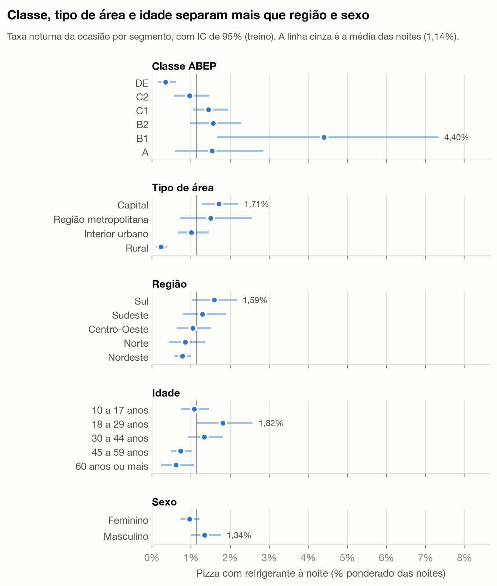

# Occasion Intelligence – Pizza + Guaraná

Projeto do case Inteli Academy x Ambev (TAPI). Estima a propensão da ocasião **Pizza + Refrigerante** por contexto (público, região, dia, período) e transforma o **Occasion Score** em uma recomendação de ativação para Guaraná Antarctica.

> Status: em construção

## Arquitetura

```
fontes (POF 2017-2018 do IBGE; Critério Brasil da ABEP)
  → src/ingestion      (download e leitura dos microdados)
  → src/features       (mês da entrevista, tipo de área, classe ABEP,
                        grade pessoa × dia × período com target e features)
  → src/models         (baseline, candidatos, avaliação, SHAP)
  → src/decision_engine(regras documentadas)
  → src/api            (FastAPI)
  → app/               (Streamlit)
```

## Estrutura do repositório

| Pasta | Conteúdo |
|---|---|
| `data/raw` | Microdados originais (não versionados) |
| `data/external` | Fontes de contexto (Vigitel, Censo, OSM, clima) |
| `data/processed` | Bases tratadas (`.parquet`) |
| `notebooks/` | EDA e experimentos |
| `src/` | Código do pipeline |
| `models/` | Modelo final congelado antes do teste e seus metadados (versionados) |
| `reports/` | Gráficos para README e vídeo (`figures/`) e tabelas da análise exploratória |
| `docs/` | Data Card, notas e regras do Decision Engine |
| `tests/` | Testes (pytest) |

## Dados

- **Fonte do target:** POF 2017–2018 (IBGE), recordatório alimentar de 24h de 46.164 pessoas.
- **Unidade de análise:** pessoa × dia × período (340.072 linhas, 838 ocasiões de pizza + refrigerante).
- **Features:** quando (período, dia da semana), onde (UF, urbano ou rural) e quem (idade, sexo, escolaridade, tamanho da família, renda per capita), escolhidas por triagem com validação cruzada no treino. Tipo de área e classe ABEP ficam para os segmentos e para o Decision Engine.
- **Validação:** split temporal pelo mês estimado da entrevista (treino jul/2017–fev/2018, teste mar–jul/2018).

Detalhes, decisões e limitações: [docs/data_card.md](docs/data_card.md) e [docs/notas_pof.md](docs/notas_pof.md).

## Análise exploratória

Só com o treino, com taxas ponderadas por `peso_semana` (o peso amostral com cada dia da semana valendo 1/7; ver Data Card, seção 7) e IC de 95% por bootstrap de UPAs ([notebooks/03_eda.py](notebooks/03_eda.py); todas as tabelas em [reports/eda_tabelas.md](reports/eda_tabelas.md)).

1. **A ocasião é da noite e cresce ao longo da semana.** A noite concentra 92% dos casos. A taxa noturna vai de 0,50% na segunda a 2,09% no sábado, e sexta a domingo têm 2,4 vezes a taxa de segunda a quinta (IC 1,7 a 3,4). Essa tabela é o baseline do modelo.

   

2. **Classe, tipo de área e idade separam a ocasião mais que região e sexo.** À noite, a taxa vai de 0,34% na classe DE a 4,40% na B1, de 0,23% no rural a 1,71% na capital e de 0,61% aos 60 anos ou mais a 1,82% aos 18–29. Mesmo assim, tipo de área e classe não melhoraram o modelo além de `urbano`, `UF`, renda e escolaridade (ver *Escolha das features*, em Metodologia), e por isso entram como segmentos e no Decision Engine.

   

3. **O salto de fim de semana muda de tamanho entre as classes.** Sexta a domingo multiplicam a taxa noturna por 3,9 na DE (IC 1,1 a 11,7) e na C2 (IC 1,7 a 8,2) e por 3,2 na B1 (IC 1,1 a 12,3), contra 1,5 na B2 (IC 0,6 a 3,2). Não há um padrão claro por renda, e os intervalos são largos: é um indício de interação, não uma prova. É o tipo de efeito que uma regra fixa como "ativar nas noites de sexta" não captura.

   

4. **Quanto mais alta a classe, mais pizza e menos refrigerante junto.** A pizza aparece em 0,5% das noites na DE e em 7,7% na A (10,1% na B1), mas vem com refrigerante em 63% das vezes na DE e em 20% na A (IC 5% a 65%). A participação do guaraná nessas ocasiões não segue a classe (de 24% a 33%, com intervalos sobrepostos); por região, vai de 14% no Norte a 31% no Centro-Oeste, também com intervalos largos. Isso sugere que, nas classes altas, a oportunidade é associar o refrigerante à pizza (awareness), mais do que disputar marca.

   

5. **Três em cada quatro pizzas são comidas em casa, e a região muda mais que a classe.** São 75% no total, com o delivery contado como casa, porque a POF não o separa. A fatia vai de 80% no Sudeste a 56% no Norte (IC 36% a 76%); por classe e tipo de área não há padrão claro. Isso sustenta o consumo em casa como regra padrão do Decision Engine, com a região como modulador.

   

## Metodologia

Protocolo fixado antes da avaliação final no período de teste (mar–jul/2018). O histórico do git registra a data desta seção.

### Occasion Score
- **Definição:** probabilidade estimada de a pessoa comer pizza e tomar refrigerante no período, dado o contexto e o perfil: `P(y = 1 | período, dia da semana, UF, urbano, idade, sexo, escolaridade, tamanho da família, renda per capita)`. O instante de previsão é o início do dia ([Data Card](docs/data_card.md), seção 3).
- **Escala:** de 0 a 1, calibrada. Como a taxa média é baixa (0,30% no treino, ponderada), a aplicação mostra também quantas vezes o score supera essa média.
- **`classification`:** `alta` para os 10% de linhas (pessoa × dia × período) com maior score, `media` para os 20% seguintes e `baixa` para o resto. Os cortes são os percentis 90 e 70 do score, ponderados por `peso_semana`, nas previsões *out-of-fold* do treino. Eles ficam fixos daí em diante e vão no `model_metadata`.

### Métrica principal e custo dos erros
- **Falso positivo:** ativação gasta num contexto sem ocasião. **Falso negativo:** ocasião de pizza + refrigerante que a ativação não alcançou.
- Com orçamento limitado, a marca ativa só o topo do ranking, e os dois custos aparecem ali: a precisão do topo mede o desperdício (FP) e o recall mede as ocasiões perdidas (FN).
- **Principal: PR-AUC** (average precision), que resume precisão × recall em todos os cortes. Um score sem sinal tem PR-AUC igual à prevalência, então o ganho se lê como múltiplo dela.
- **Leitura de negócio: captura no top 10%**, a fração das ocasiões que cai nos 10% de linhas com maior score.
- **Por que não acurácia nem ROC-AUC:** com 99,7% de negativos, as duas ficam altas mesmo com um topo ruim. O ROC-AUC entra como complementar.

### Baseline e candidatos
- **Baseline:** taxa ponderada de `y` por dia da semana × período no treino (28 células), usada diretamente como score. É o "sexta à noite é bom para pizza" em forma de número.
- **Regressão Logística:** categóricas em one-hot, numéricas padronizadas (anos de estudo, moradores e log da renda per capita) e regularização L2; `regiao` no lugar de `UF` (27 categorias são muitas para 523 positivos), `faixa_idade` no lugar de `idade` (o efeito da idade não é linear) e interação período × dia da semana, para conter o baseline.
- **LightGBM raso:** poucas folhas e `min_child_samples` alto, porque o treino tem só 523 positivos.
- **Preparo único:** todo modelo começa pelo mesmo preparo de features ([src/models/preparo.py](src/models/preparo.py)), que a API e o app também usam. Ele não aprende nada dos dados, porque faixas e regiões são fixas, e recusa valores que o modelo não conhece.

### Validação
1. **Validação cruzada repetida no treino** (jul/2017–fev/2018): `StratifiedGroupKFold` com 5 folds, agrupado por domicílio para que a mesma família (que divide a pizza) não fique dos dois lados, e repetido 10 vezes com partições diferentes. Com só 523 positivos, uma única partição é ruidosa demais para decidir. A PR-AUC ponderada decide:
   - o modelo final (Regressão Logística ou LightGBM);
   - as alternativas do Data Card: dia da semana ou fim de semana, renda contínua ou em faixas;
   - hiperparâmetros, uso do `peso_semana` no ajuste e calibração (sigmoide sobre as previsões *out-of-fold*, se a curva de confiabilidade pedir).

   Entre duas opções, a mais complexa só vence se o ganho for significativo a 5% no teste t corrigido para validação cruzada repetida (Nadeau e Bengio, 2003); senão, fica a mais simples. Os hiperparâmetros seguem só a maior PR-AUC média.
2. **Teste temporal** (mar–jul/2018): o modelo escolhido, treinado em todo o treino, é avaliado **uma única vez**, ao lado do baseline. Nada é reajustado depois; qualquer mudança posterior é reportada como exploratória. A aplicação usa esse mesmo modelo.
3. **Generalização por região** (complementar): dentro do treino, ajustar com 4 regiões e avaliar na 5ª.

**Escolha das features.** Uma triagem com essa validação cruzada repetida, só no treino ([notebooks/02_triagem_features.py](notebooks/02_triagem_features.py)), testou cinco grupos de candidatas: tipo de área, classe ABEP, composição da família, bens e finanças, trabalho e estudo. Nenhum trouxe ganho significativo, nem no LightGBM nem na Regressão Logística, então ficaram as 9 features de partida ([Data Card](docs/data_card.md), seção 3). Versões anteriores da triagem, uma medida no período de teste e outra com uma única partição, foram substituídas por esta. As features não mudam depois do teste.

### Avaliação no teste
- **Métricas, sempre ao lado do baseline:** PR-AUC; captura no top 5%, 10% e 20%; ROC-AUC; precisão, recall, F1 e matriz de confusão no corte de `alta`; Brier e curva de calibração.
- **Peso:** métricas ponderadas por `peso_semana`, o PESO_FINAL ajustado para cada dia da semana valer 1/7. O PESO_FINAL expande pessoas, não dias, e a amostra tem poucas sextas e sábados (9% e 5% dos dias). A versão sem peso fica como checagem.
- **Incerteza:** intervalos de 95% por bootstrap de UPAs (1.000 reamostragens), como na análise exploratória. A UPA é a unidade primária da amostra e contém os domicílios, onde os positivos se concentram (os 315 do teste estão em 189 domicílios). O modelo só é declarado melhor que o baseline se o intervalo da diferença de PR-AUC (bootstrap pareado) não incluir zero.
- **Mudança de prevalência:** a taxa sobe de 0,30% no treino para 0,41% no teste. A comparação com o baseline é sempre no mesmo conjunto, e o score não é recalibrado com o teste.
- **Segmentos:** período, região, tipo de área e público (classe ABEP, faixa etária, sexo). Para canal, usa-se o local onde a pizza foi comida (`local_pizza`: casa, estabelecimento ou outro lugar fora). Como o local só existe para quem comeu pizza, o resultado por canal é a captura das ocasiões de cada local. Segmentos com menos de 30 positivos no teste são só descritos, sem métrica.
- **Erros:** perfil das ocasiões que ficaram em `baixa` (falsos negativos) e dos contextos em `alta` sem ocasião (falsos positivos).
- **Explicações:** SHAP global e local. Os 3 fatores de maior contribuição de cada previsão formam o `top_factors` da API.

## Resultados

### Seleção do modelo (validação cruzada no treino)

Tudo no treino, com as 50 partições e as regras da Metodologia ([notebooks/04_modelagem.py](notebooks/04_modelagem.py)). PR-AUC e captura são ponderadas por `peso_semana`. A prevalência, que é a PR-AUC de um score sem sinal, é 0,0030. Cada passo parte do vencedor do anterior, e a opção mais complexa só vence com ganho significativo.

| Passo | Mais simples (PR-AUC) | Mais complexa (PR-AUC) | Ganho da mais complexa (p) | Fica |
|---|---|---|---|---|
| Modelo | baseline dia × período (0,0160) | Regressão Logística (0,0386) | +0,0226 (0,006) | Regressão Logística |
| Dia | fim de semana (0,0371) | dia da semana (0,0386) | +0,0015 (0,40) | fim de semana |
| Renda | contínua (0,0371) | 5 faixas (0,0306) | −0,0065 (0,76) | contínua |
| Peso no ajuste | sem peso (0,0371) | `peso_semana` (0,0414) | +0,0043 (0,22) | sem peso |
| Algoritmo | Regressão Logística (0,0371) | LightGBM raso, melhor de 6 (0,0284) | −0,0087 (0,82) | Regressão Logística |

- **Quais opções contam como mais simples** ficou escrito no notebook antes de rodar. Para as alternativas do Data Card e para o LightGBM, isso segue o número de parâmetros.
- **O peso no ajuste** era a decisão sem uma ordem óbvia. O ajuste sem peso foi tratado como o mais simples. O ajuste com peso teve a maior PR-AUC média, mas oscilou mais entre os folds (desvio-padrão de 0,0245 contra 0,0188), e o ganho não foi significativo. Tratado como hiperparâmetro (maior média), ele teria vencido.
- **Modelo escolhido:** Regressão Logística com regularização L2 (C = 0,003), ajustada sem peso. Usa:
  - período, fim de semana (sexta a domingo) e a interação período × fim de semana;
  - região, urbano, faixa etária e sexo;
  - anos de estudo, moradores e log da renda per capita.
- **Desempenho na validação cruzada:** PR-AUC 0,0371, 12,3 vezes a prevalência, contra 0,0160 do baseline (ganho +0,0211, p = 0,013, à frente em 48 de 50 folds). Captura no top 10%: 66,9%, contra 54,2% do baseline.

**Calibração.** A regularização forte deixa o score achatado em torno da média. Nas previsões out-of-fold:
- **Sem sigmoide:**
  - a média ficava abaixo da taxa ponderada (0,259% contra 0,302%);
  - no 1% de maior score, a previsão era 1,18% contra 4,45% observados;
  - na metade de baixo, 0,13% contra 0,02%.
- **Com sigmoide:** a sigmoide ponderada (a = 2,50, b = +8,23) estica o score sem mudar a ordem. Medida com a sigmoide ajustada fora de cada fold:
  - reduziu o log loss ponderado de 0,01796 para 0,01667 (p < 0,001);
  - acertou o nível geral (0,304% previsto contra 0,302%).
- **Desvios que ficam:**
  - no topo: no 1% de maior score, 5,7% previsto contra 4,4% observado; entre 5% e 10%, 1,1% contra 1,6%;
  - por dia, porque o modelo junta sexta com sábado e domingo: a sexta fica acima (0,47% previsto contra 0,31%) e a quinta abaixo (0,18% contra 0,28%).

**Modelo final.** O modelo final foi ajustado em todo o treino com C × 4/5 = 0,0024 ([src/models/treinar.py](src/models/treinar.py)).
- **Por quê:** no scikit-learn, o mesmo C regulariza relativamente menos quando há mais linhas. Cada modelo da validação cruzada usou 4/5 do treino, e a sigmoide foi ajustada nas previsões deles.
- **O efeito:** com o C da validação, o modelo final saía menos achatado, e o score calibrado ficava 16% acima da taxa do treino (0,351% contra 0,302%). Com C × 4/5, fica em 0,302%.
- **Quando foi feito:** tudo isso foi detectado e corrigido só com o treino, antes do teste.

O modelo, a sigmoide, os cortes e as métricas estão em [models/](models/).

**Classificação.** Os cortes são fixos e vão no `model_metadata`. Os números abaixo são das previsões out-of-fold calibradas do treino:

| Classe | Score | Contextos | Ocasiões capturadas | Taxa observada | Vezes a média |
|---|---|---|---|---|---|
| `alta` | a partir de 0,777% | 10% | 67,0% | 2,03% | 6,7 |
| `media` | de 0,144% a 0,777% | 20% | 27,4% | 0,41% | 1,4 |
| `baixa` | abaixo de 0,144% | 70% | 5,6% | 0,02% | 0,1 |

### Avaliação no teste

_A preencher. O teste (mar–jul/2018) é aberto uma única vez, com o modelo de [models/](models/)._

## Limitações

- **Calibração por dia:** o modelo usa fim de semana, e não o dia da semana, porque o dia não trouxe ganho significativo de PR-AUC. Por isso, ele dá a mesma probabilidade para sexta e domingo e para segunda e quinta, e a calibração por dia herda isso (Resultados).
- **Calibração no topo:** a sigmoide tem dois parâmetros e corrige o nível e a escala, não cada faixa do ranking. No 1% de maior score, ela superestima a taxa.

_A completar com a avaliação no teste._

## Como executar

```bash
uv venv --python 3.12
source .venv/bin/activate
uv pip install -r requirements.txt
```

### Pipeline de dados

```bash
python -m src.ingestion.download_pof     # baixa e extrai a POF 2017-2018 (~150 MB)
python -m src.ingestion.pof              # lê os arquivos de largura fixa → data/processed/*.parquet
python notebooks/01_verificacao_pof.py   # sanidade da leitura, contagem da ocasião, validação do mês
python -m src.features.build_grid        # grade pessoa × dia × período → data/processed/grid.parquet
python notebooks/02_triagem_features.py  # triagem de features com validação cruzada, só no treino
python notebooks/03_eda.py               # análise exploratória (só treino) → reports/figures/
python notebooks/04_modelagem.py         # seleção do modelo na validação cruzada, só no treino
python -m src.models.treinar             # modelo final → models/ (congelado antes do teste)
```

### Testes

```bash
python -m pytest
```

_Comandos da API e do app a preencher._
